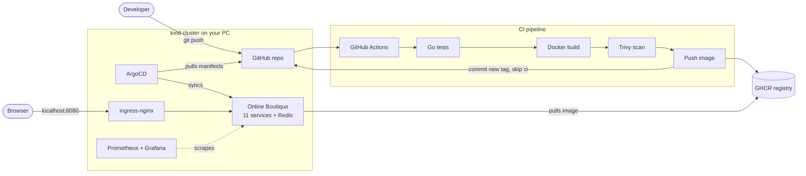

# Online Boutique GitOps

A portfolio-grade GitOps platform for Google's [Online Boutique](https://github.com/GoogleCloudPlatform/microservices-demo) microservices demo, running on a **local Kubernetes (kind) cluster** with a fully automated CI/CD pipeline.

Push a change to the storefront, and a few minutes later it is live on `http://localhost:8080`. Nobody runs `kubectl apply`.

> Maintained by **ALIYAN MALIK**. The upstream app is Apache-2.0 licensed (see `LICENSE` and `NOTICE`).

<!-- Add your screenshots here (see docs/RUNBOOK.md, section "Screenshots to capture") -->

## What this project demonstrates

| Area | What you will find |
|---|---|
| GitOps | ArgoCD watches this repo; Git is the single source of truth (pull-based, `prune` + `selfHeal`) |
| CI | GitHub Actions: Go tests, Docker build, Trivy scan (fails on CRITICAL), push to GHCR |
| CD | The pipeline commits the new image tag to the dev overlay; ArgoCD rolls it out |
| Kubernetes | 11 microservices + Redis, requests/limits and probes on every workload, Ingress, Kustomize overlays |
| Supply-chain hygiene | Every image and tool version pinned, every GitHub Action pinned to a commit SHA |
| Observability | Prometheus + Grafana (kube-prometheus-stack) tuned for a laptop |
| Product work | A customized storefront: dark mode switch, "Customize UI" panel, owner credit |

## Architecture



The cluster **pulls** from Git. GitHub never needs network access to your PC and CI never holds cluster credentials, which is the main security argument for GitOps.

## The customized storefront

Only the `frontend` service is built by this repo's pipeline. The other 10 services and Redis run from the pinned upstream v0.10.7 images.

- **Dark mode switch** in the header (ON/OFF). Follows the OS preference on the first visit, remembers your choice, and is applied before first paint so there is no flash.
- **Customize UI** panel: 4 color themes (Default, Ocean, Sunset, Forest), layout density (Comfortable/Compact), font size (Small/Medium/Large), product grid columns (2/3/4), and a Reset button. Saved in `localStorage`.
- **Owner credit** `ALIYAN MALIK` fixed in the bottom-right corner of every page. The name lives in one file: `src/frontend/templates/owner.html`.

Implementation: plain HTML, CSS variables and vanilla JavaScript (`static/styles/theme.css`, `static/js/theme.js`). No new frameworks, no Go backend changes.

## Repository layout

```
.
├── src/frontend/            customized frontend (Go app, templates, static assets, Dockerfile, tests)
├── k8s/
│   ├── base/                upstream v0.10.7 manifests + Ingress
│   └── overlays/{dev,prod}/ image tag, replicas, load generator, namespace
├── argocd/                  ArgoCD Applications (dev: automated, prod: manual sync)
├── monitoring/values.yaml   kube-prometheus-stack values for a small cluster
├── kind/kind-config.yaml    1 control-plane + 2 workers, port 8080 -> ingress
├── .github/workflows/       ci.yaml, pr.yaml, promote.yaml
├── docs/RUNBOOK.md          step-by-step guide, verification checklist, screenshots list
└── Makefile                 make up | monitor | status | destroy
```

## Quick start

Full guide with verification steps: [`docs/RUNBOOK.md`](docs/RUNBOOK.md).

```bash
make configure GH_USER=YOUR_GH_USER   # one-time: set your GitHub username
git add -A && git commit -m "configure" && git push   # first push triggers the pipeline
# GitHub: make the GHCR package public (see runbook), then:
make up                               # kind + ingress-nginx + ArgoCD + the app
make monitor                          # optional: Prometheus + Grafana
open http://localhost:8080
```

## Design decisions

**Why GitOps (pull-based)?** Deployments become auditable Git commits, rollback is `git revert`, drift is corrected automatically, and CI never needs cluster credentials.

**Why kind?** It runs real Kubernetes (multi-node) in Docker, costs nothing, starts in about a minute, and behaves like a managed cluster for everything this project needs.

**Why build only the frontend in CI?** The other services are unmodified upstream code. Rebuilding ten services would add 20+ minutes of CI and a lot of RAM for no portfolio value. The pipeline pattern is identical for any service you later customize.

**Why Kustomize?** Plain YAML with overlays is easy to review in a PR and has no templating language to learn. The base is the untouched upstream release manifest.

**Why a manifest commit-back instead of ArgoCD Image Updater?** One explicit commit per release gives a clear audit trail and an easy rollback target, with no extra controller to run on a small PC.

**Why SHA-pinned actions?** In March 2026 most `aquasecurity/trivy-action` version tags were force-pushed to malware. A tag is a mutable pointer; a commit SHA is not. Trivy itself is pinned to a known-safe binary version.

**Resource budget.** The dev overlay requests about 1.6 CPU and 1.4 GB RAM (limits about 2.8 CPU / 2.5 GB), which leaves room for ArgoCD and monitoring inside a 4 CPU / 8 GB Docker allocation. The load generator is set to 2 users.

## Troubleshooting

| Symptom | Cause and fix |
|---|---|
| `ImagePullBackOff` on `frontend` | The GHCR package is private by default. GitHub profile > Packages > `online-boutique-frontend` > Package settings > Change visibility > Public (or create an `imagePullSecret`). |
| CI fails at "git push" with 403 | Repo Settings > Actions > General > Workflow permissions > **Read and write permissions**. |
| `kind create cluster` fails or nodes keep restarting | Not enough Docker resources. Give Docker at least 4 CPUs and 8 GB RAM, close other heavy apps, or turn off the load generator. |
| `bind: address already in use` on 8080 | Another program uses port 8080. Change `hostPort: 8080` in `kind/kind-config.yaml` and recreate the cluster. |
| Store works but still shows the old UI | The dev overlay still points at the upstream image because CI has not finished (or failed). Check the Actions tab and `git pull` to get the bot's commit. |
| ArgoCD app stuck `OutOfSync` or "repository not found" | Wrong username in `argocd/application-dev.yaml` (run `make configure`), or the repo is private (add repo credentials in ArgoCD, or make the repo public). |
| I scaled something by hand and it reverted | That is `selfHeal` working. Change replicas in the overlay and push instead. |
| Pods `Pending` | Out of node resources. See "If the PC struggles" in the runbook. |

## Next improvements

- HPA on the frontend, plus Argo Rollouts for canary releases
- TLS on the Ingress (cert-manager with a local CA)
- Terraform to provision the same stack on EKS
- Migrate from ingress-nginx to the Gateway API (the ingress-nginx project has been winding down)
- Trivy scan of the Kubernetes manifests, Kyverno policies, image signing with cosign
- Renovate or Dependabot for SHA-pinned action updates
- Real Prometheus metrics and alerts for the storefront
